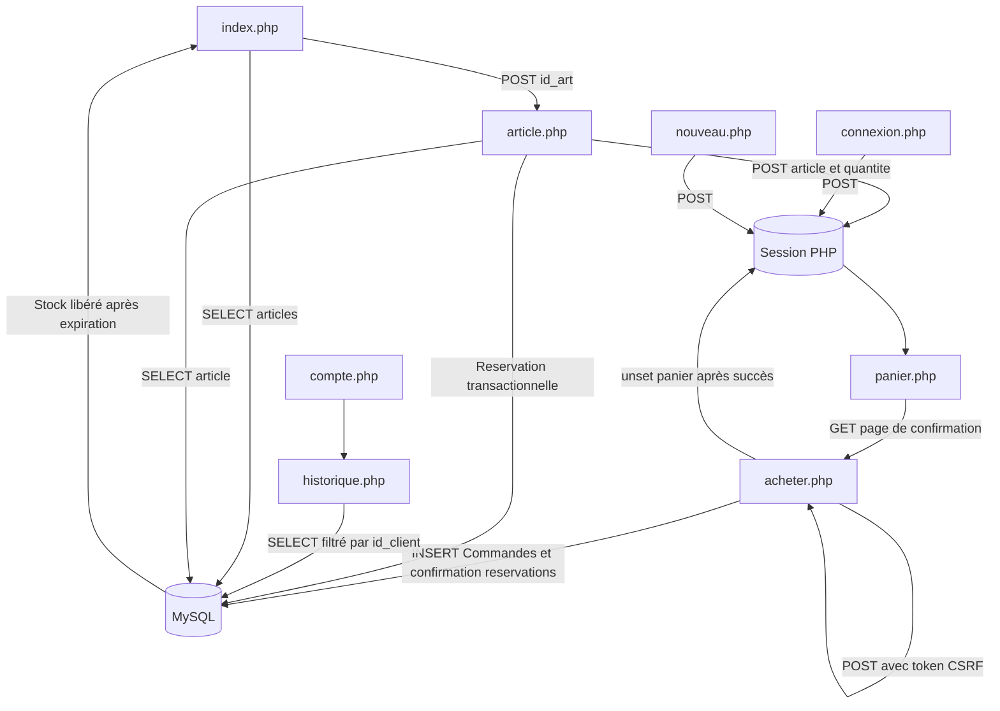

# Architecture de Frames & cores

## 1. Vue d'ensemble

Frames & cores est un site de vente de matériel informatique développé sans framework.
Les pages PHP rendent les vues et traitent directement les formulaires. PDO centralise
les échanges avec MySQL, tandis que les sessions PHP conservent l'identité du client et
son panier entre deux requêtes.

Technologies utilisées :

- **PHP 8.0 ou supérieur** pour le rendu serveur et la logique métier ;
- **MySQL** pour les articles, les utilisateurs et les commandes ;
- **PDO** pour les requêtes préparées et les transactions ;
- **HTML/CSS** pour la structure et l'interface ;
- **Sessions PHP** pour l'authentification et le panier.

Le code reste volontairement limité aux fonctionnalités communes à PHP 8.0, PHP 8.1,
PHP 8.2, PHP 8.3 et PHP 8.4. Les extensions `PDO_MySQL` et `mbstring` doivent être
activées sur le serveur.

Les commentaires placés dans les blocs PHP sont traités côté serveur. Ils documentent
le code source et ne sont donc pas envoyés dans le HTML généré.

## 2. Arborescence

```text
TyldenHounsa/
|-- index.php                         Catalogue et accueil
|-- article.php                       Fiche et ajout au panier
|-- panier.php                        Consultation et validation du panier
|-- acheter.php                       Enregistrement d'une commande
|-- historique.php                    Historique du client connecté
|-- compte.php                        Espace du client
|-- connexion.php                     Formulaire de connexion
|-- nouveau.php                       Formulaire de création de compte
|-- contact.html                      Page statique de contact
|-- ARCHITECTURE.md                   Documentation technique
|
|-- assets/
|   |-- css/style.css                 Feuille de style commune
|   |-- js/main.js                    Fichier conservé, sans logique active
|   |-- js/panier.js                  Fichier réservé aux évolutions du panier
|   `-- images/                        Images des produits
|
|-- includes/php/
|   |-- bd.php                        Connexion PDO à MySQL
|   |-- csrf.php                      Génération et validation des tokens CSRF
|   |-- reservation.php                Réservations, expiration et libération du stock
|   |-- submit_connexion.php          Traitement de la connexion
|   |-- submit_formulaire.php         Traitement de l'inscription
|   `-- disconnect.php                Fermeture de session
|
`-- database/
    |-- computer_database.sql         Schéma et données initiales
    `-- add_reservations.sql          Migration non destructive des réservations
```

## 3. Flux applicatif



## 4. Parcours du catalogue et du panier

### Catalogue

`index.php` démarre la session, charge les articles depuis la table `articles` et
échappe les valeurs avant leur insertion dans le HTML. Chaque carte contient un
formulaire `POST` vers `article.php` avec les champs cachés `id_art` et
`csrf_token`.

La fiche n'est donc plus ouverte par une redirection JavaScript ou par un identifiant
placé dans l'URL.

### Fiche article

`article.php` récupère `id_art` depuis `$_POST`, puis recherche l'article avec une
requête préparée. Le formulaire d'ajout renvoie l'identifiant, l'action et la quantité.

Lors d'un ajout au panier, le serveur :

1. vérifie que le client est connecté ;
2. vérifie que la quantité est un entier positif ;
3. verrouille la ligne de l'article dans une transaction ;
4. vérifie le stock disponible ;
5. diminue le stock et crée ou met à jour une réservation active ;
6. fixe une date d'expiration selon la durée configurée.

La session conserve une copie d'affichage, mais la base est la source de vérité.
Les réservations actives du client constituent le panier réel :

```php
$_SESSION['panier'][id_art] = quantite;
```

### Panier

`panier.php` relit les réservations actives et les informations des articles depuis
MySQL. La session ne fait pas autorité pour les quantités, les prix ou le stock. La
page calcule chaque sous-total ainsi que le total général et affiche le temps restant
de chaque réservation.

Le bouton de suppression est traité par `panier.php` en `POST`. Il utilise
une transaction pour remettre les quantités réservées en stock, passe les
réservations à l'état `annulee`, vide la session, puis redirige vers la même page.

## 5. Authentification et sessions

`submit_connexion.php` recherche l'utilisateur par e-mail et vérifie le mot de passe
avec `password_verify()`. Après une connexion réussie, l'identifiant est conservé avec
les informations d'affichage :

```php
$_SESSION['id_client'] = $utilisateur['id_user'];
$_SESSION['nom'] = $utilisateur['nom'];
$_SESSION['prenom'] = $utilisateur['prenom'];
```

`submit_formulaire.php` crée le compte avec `password_hash()`, récupère l'identifiant
généré par MySQL et initialise les mêmes valeurs de session.

`compte.php` est accessible uniquement lorsque le nom et le prénom sont présents dans
la session. Le lien vers `historique.php` permet au client de consulter ses commandes.

## 6. Protection CSRF

`includes/php/csrf.php` centralise la protection contre les requêtes intersites.
Les pages contenant une action génèrent un token aléatoire, placé dans le champ
caché `csrf_token` de leur formulaire. Le serveur vérifie ce token avant toute
modification de session ou de base de données.

La session conserve au maximum deux tokens valides. Lorsqu'un troisième token est
généré, le plus ancien est supprimé ; une page utilisant ce token reçoit alors une
réponse HTTP `403`. Les actions protégées sont l'inscription, la connexion, l'ajout
au panier, la suppression du panier, la déconnexion et la validation d'une commande.

## 7. Réservations temporaires

`includes/php/reservation.php` centralise les opérations de réservation et de
libération du stock. Les deux constantes suivantes permettent de modifier les durées
sans changer les traitements :

- `CART_RESERVATION_DURATION_SECONDS` : durée globale d'une réservation dans le panier ;
- `LAST_STOCK_RESERVATION_DURATION_SECONDS` : durée appliquée lorsque la réservation
  fait tomber le stock disponible à zéro.

Les deux valeurs sont exprimées en secondes. Par défaut, la durée globale est de
quinze minutes et la durée des derniers exemplaires est de cinq minutes.
Les dates de réservation sont enregistrées et comparées en UTC, à la fois par PHP et
par MySQL, afin d'éviter les expirations immédiates liées au fuseau horaire local.

## 8. Enregistrement d'une commande

`acheter.php` exige un `id_client` valide et au moins une réservation active. Une
requête `GET` affiche uniquement une page de confirmation. L'enregistrement réel est
déclenché par un formulaire `POST` contenant un token CSRF valide.

Le traitement utilise ensuite une transaction PDO :

1. les réservations actives du client sont verrouillées avec `SELECT ... FOR UPDATE` ;
2. chaque article est inséré dans `Commandes` avec `envoi = FALSE` ;
3. les réservations sont passées à l'état `confirmee` ;
4. le stock n'est pas décrémenté une seconde fois, car il l'a été lors de la réservation ;
5. la transaction est validée avec `commit()` ;
6. le panier de session est supprimé après cette validation.

En cas d'erreur, `rollBack()` annule les écritures réalisées pendant la transaction et
le panier reste disponible pour une nouvelle tentative.

Les réservations dépassant leur date d'expiration sont nettoyées avant les opérations
sur le catalogue, la fiche article, le panier et la commande. Leur quantité est
remise dans `articles.quantite` et leur statut devient `expiree`.

## 9. Historique des commandes

`historique.php` est réservé au client connecté. Sa requête filtre les lignes avec
`c.id_client = :id_client` et joint `articles` pour afficher le nom et le prix du
produit.

Le tableau présente :

- l'identifiant de commande ;
- l'article commandé ;
- la quantité ;
- le total de la ligne ;
- l'état d'envoi.

La colonne `envoi` vaut `FALSE` lors de l'achat et peut être passée manuellement à
`TRUE` par le gestionnaire.

## 10. Base de données

Le script `database/computer_database.sql` crée les tables `articles`, `user`,
`reservations` et `Commandes`. Les tables utilisant des relations sont en `InnoDB`.
Pour une base déjà installée, `database/add_reservations.sql` permet d'ajouter la
table `reservations` sans supprimer les données existantes.

Structure de `articles` :

| Colonne | Type | Rôle |
|---|---|---|
| `id_art` | `int` | Identifiant auto-incrémenté et clé primaire de l'article |
| `nom` | `varchar(150)` | Nom de l'article |
| `quantite` | `int` | Quantité disponible en stock, initialisée à `0` |
| `prix` | `float` | Prix de l'article |
| `url_photo` | `varchar(255)` | Chemin de l'image de l'article, facultatif |
| `description` | `text` | Description de l'article, facultative |

Structure de `user` :

| Colonne | Type | Rôle |
|---|---|---|
| `id_user` | `int UNSIGNED` | Identifiant auto-incrémenté et clé primaire du client |
| `nom` | `varchar(100)` | Nom du client |
| `prenom` | `varchar(100)` | Prénom du client |
| `adr` | `varchar(255)` | Adresse du client |
| `num` | `varchar(30)` | Numéro de téléphone du client |
| `mail` | `varchar(254)` | Adresse e-mail unique du client |
| `mdp` | `varchar(255)` | Mot de passe stocké sous forme de hash |

Structure de `reservations` :

| Colonne | Type | Rôle |
|---|---|---|
| `id_reservation` | `int` | Identifiant auto-incrémenté de la réservation |
| `id_client` | `int UNSIGNED` | Client qui possède la réservation |
| `id_art` | `int` | Article réservé |
| `quantite` | `int` | Quantité retirée temporairement du stock disponible |
| `date_reservation` | `datetime` | Date et heure de création |
| `date_expiration` | `datetime` | Date et heure auxquelles le stock est libéré |
| `statut` | `enum` | `active`, `confirmee`, `expiree` ou `annulee` |

La table possède des clés étrangères vers `user` et `articles`, ainsi que des index
sur l'article, le client, le statut et la date d'expiration.

Structure de `Commandes` :

| Colonne | Rôle |
|---|---|
| `id_commande` | Identifiant auto-incrémenté de la ligne commandée |
| `id_art` | Article commandé et clé étrangère vers `articles` |
| `id_client` | Client et clé étrangère vers `user` |
| `quantite` | Quantité commandée |
| `envoi` | État d'envoi, `FALSE` par défaut |

Chaque article d'un panier est enregistré sur une ligne distincte. La structure
conserve ainsi tous les champs demandés tout en permettant une commande composée de
plusieurs articles.

## 11. Sécurité et intégrité

- Les requêtes utilisent des paramètres PDO afin d'éviter la concaténation de valeurs
  fournies par l'utilisateur.
- Les valeurs affichées sont échappées avec `htmlspecialchars()`.
- Les mots de passe sont hachés avec `password_hash()` et vérifiés avec
  `password_verify()`.
- L'identifiant de session est régénéré après une connexion réussie.
- Les actions qui modifient l'état utilisent des formulaires `POST` protégés par des
  tokens CSRF.
- Deux tokens CSRF au maximum sont conservés par session, selon une file FIFO.
- Les quantités et les identifiants sont validés côté serveur.
- Une commande ne peut pas être créée par une simple requête `GET`.
- La transaction de commande protège la cohérence entre `Commandes` et `articles`.
- La réservation verrouille l'article avec `FOR UPDATE` avant de diminuer le stock.
- Une réservation expirée restitue sa quantité au stock dans une transaction.
- Les données de la page d'historique sont filtrées par le client connecté.

## 12. Évolutions possibles

- déplacer les identifiants MySQL de `bd.php` vers des variables d'environnement ;
- ajouter une gestion dédiée des lignes d'une même commande si un identifiant de
  commande commun doit être affiché pour plusieurs articles ;
- ajouter des tests automatisés pour le panier, le stock et la transaction ;
- ajouter une interface d'administration pour modifier `envoi`.
